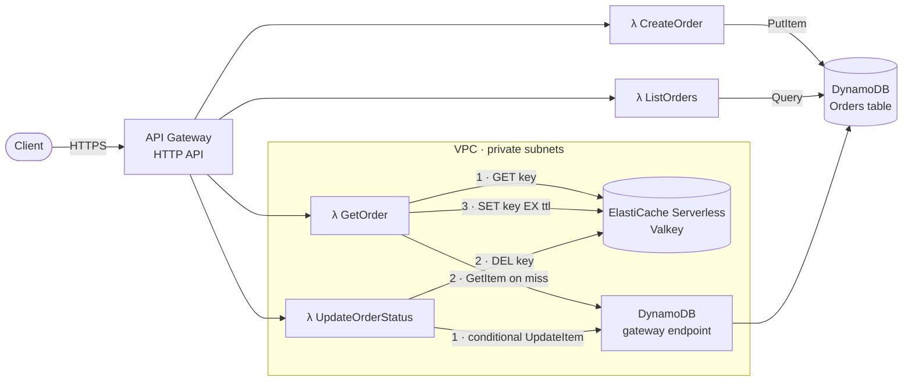
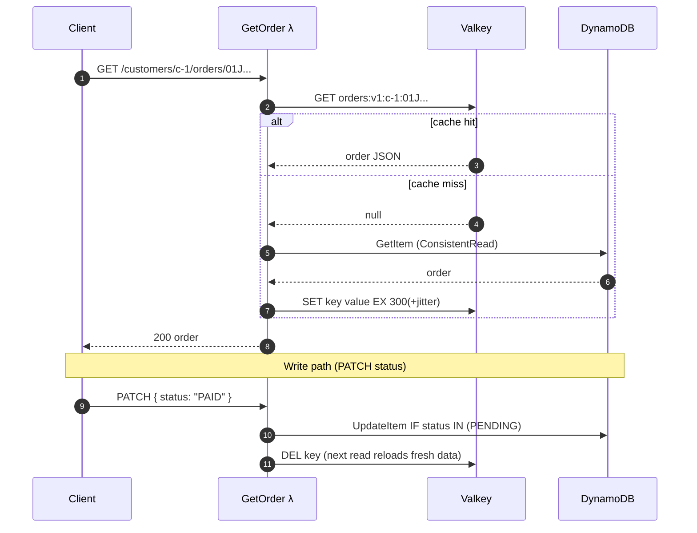

# Serverless Orders API

A production-style REST API for managing customer orders on AWS, built with **TypeScript**, **AWS Lambda**, **Amazon API Gateway**, **Amazon DynamoDB** and **Amazon ElastiCache Serverless (Valkey)**, and defined as infrastructure-as-code with **AWS SAM**.

**Highlights**

- **Single-table DynamoDB design.** The composite primary key is `PK = CUSTOMER#<id>`, `SK = ORDER#<ULID>`. Every access pattern is a `GetItem` or a single-partition `Query`, so the API never runs a scan.
- **Cache-aside caching** with ElastiCache Serverless (Valkey):
  - reads load the cache lazily, with a TTL plus jitter
  - writes invalidate the cached entry
  - a strongly consistent read on a miss avoids putting stale data back in the cache
  - requests still succeed when the cache is down (fail-open)
  - CloudWatch metrics count hits, misses and errors
- **Atomic order state machine.** DynamoDB condition expressions enforce valid status changes in a single request, so there is no read-then-write race.
- **AWS SAM template:**
  - four least-privilege Lambda functions on arm64
  - an HTTP API with throttling and access logs
  - a private VPC with a DynamoDB gateway endpoint (no NAT Gateway)
  - a parameter that turns the cache on or off
- **Tested end to end.** Unit tests cover the business logic. Integration tests run the real handlers against DynamoDB Local and Valkey. GitHub Actions runs CI and deploys with OIDC, so no AWS keys are stored in GitHub.

---

## Architecture



Only the two functions that use the cache are attached to the VPC. ElastiCache is reachable only from inside a VPC. The private subnets have no route to the internet, so a free **DynamoDB gateway endpoint** gives those functions a private route to DynamoDB. That avoids paying for a NAT Gateway.

### Cache-aside: read and write paths



---

## API

Base URL: the `ApiUrl` output of the stack, or `http://127.0.0.1:3000` when running with `sam local`.

| Method  | Path                                       | Description                                  | Success            |
| ------- | ------------------------------------------ | -------------------------------------------- | ------------------ |
| `POST`  | `/customers/{customerId}/orders`           | Create an order                              | `201` + `Location` |
| `GET`   | `/customers/{customerId}/orders`           | List a customer's orders, newest first       | `200`              |
| `GET`   | `/customers/{customerId}/orders/{orderId}` | Get one order (served via cache-aside)       | `200`              |
| `PATCH` | `/customers/{customerId}/orders/{orderId}` | Change the order status `{"status": "PAID"}` | `200`              |

The list endpoint accepts these query parameters:

- `limit`: 1–100, default 20
- `from` and `to`: ISO-8601 datetimes, inclusive
- `nextToken`: the opaque pagination token from the previous page

**Status lifecycle**

```
PENDING ──► PAID ──► SHIPPED ──► DELIVERED
   │          │
   └──────────┴──► CANCELLED
```

**Errors** use one envelope and stable codes: `400 VALIDATION_ERROR`, `404 NOT_FOUND`, `409 CONFLICT` (invalid status change) and `500 INTERNAL_ERROR`.

```json
{
  "error": {
    "code": "CONFLICT",
    "message": "Cannot change order status from PENDING to DELIVERED",
    "details": { "currentStatus": "PENDING", "requestedStatus": "DELIVERED" }
  }
}
```

**Example**

```bash
API=http://127.0.0.1:3000

curl -s -X POST "$API/customers/c-123/orders" \
  -H 'content-type: application/json' \
  -d '{"currency":"USD","items":[{"sku":"KB-01","name":"Mechanical keyboard","quantity":1,"unitPrice":8999}]}'

curl -s "$API/customers/c-123/orders?limit=10&from=2026-01-01T00:00:00Z"
curl -s -X PATCH "$API/customers/c-123/orders/<orderId>" -H 'content-type: application/json' -d '{"status":"PAID"}'
```

Amounts are **integers in cents** (`unitPrice: 8999` = $89.99), which avoids floating-point rounding errors.

---

## Data model

A single table with a composite primary key:

| Attribute                                                              | Example                            | Role                                               |
| ---------------------------------------------------------------------- | ---------------------------------- | -------------------------------------------------- |
| `PK`                                                                   | `CUSTOMER#c-123`                   | **Partition key**: groups all orders of a customer |
| `SK`                                                                   | `ORDER#01JA2B3C4D5E6F7G8H9JKMNPQR` | **Sort key**: orders them by creation time (ULID)  |
| `entityType`                                                           | `ORDER`                            | Entity discriminator (single-table design)         |
| `status`, `items`, `totalAmount`, `currency`, `createdAt`, `updatedAt` |                                    | Order attributes                                   |

| Access pattern                         | DynamoDB operation | Key condition / expression                                         |
| -------------------------------------- | ------------------ | ------------------------------------------------------------------ |
| Create order                           | `PutItem`          | `attribute_not_exists(PK)`: never overwrite                        |
| Get order                              | `GetItem`          | `PK = CUSTOMER#c` and `SK = ORDER#id`                              |
| List a customer's orders, newest first | `Query`            | `PK = :pk AND begins_with(SK, 'ORDER#')`, `ScanIndexForward=false` |
| …created between two dates             | `Query`            | `PK = :pk AND SK BETWEEN :start AND :end` (ULID time prefix)       |
| Change status                          | `UpdateItem`       | `attribute_exists(PK) AND #status IN (:allowedPrevious…)`          |

Order IDs are **ULIDs**. They are unique like UUIDs, but the first 48 bits are a timestamp, so they sort lexicographically by creation time. That means the sort key gives chronological ordering and date-range queries without any extra index. See [docs/architecture.md](docs/architecture.md) for the full reasoning and the alternatives that were considered.

---

## Getting started

### Prerequisites

- Node.js 22+ and npm
- Docker (for DynamoDB Local, Valkey and `sam local`)
- [AWS SAM CLI](https://docs.aws.amazon.com/serverless-application-model/latest/developerguide/install-sam-cli.html)
- AWS credentials (only needed to deploy)

### Install and test

```bash
npm install
npm test                    # unit tests
npm run local:up            # DynamoDB Local on :8100, Valkey on :6380
npm run test:integration    # handlers against real DynamoDB Local + Valkey
npm run lint && npm run typecheck
```

### Run the API locally with SAM

```bash
npm run local:up            # start DynamoDB Local + Valkey
npm run local:table         # create the table in DynamoDB Local
npm run local:api           # sam build + sam local start-api on http://127.0.0.1:3000
npm run smoke -- http://127.0.0.1:3000
```

> Run SAM through the npm scripts (`npm run build`, `npm run local:api`, …). npm puts `node_modules/.bin` on the `PATH`, which is how SAM finds the project's `esbuild`. You can also install esbuild globally.

### Deploy to AWS

```bash
npm run deploy:guided       # first deployment: sam build + sam deploy --guided
npm run deploy              # later deployments (uses samconfig.toml)
npm run smoke -- <ApiUrl>   # end-to-end check against the deployed stack
sam delete                  # tear everything down
```

The cache layer adds a small fixed cost: ElastiCache Serverless bills a minimum amount of storage. For a cheaper stack without the VPC and cache, deploy with `EnableCache=false`:

```bash
sam deploy --config-env nocache
```

The API works the same way without the cache. Every read just goes to DynamoDB.

> Stacks with VPC-attached Lambda functions can take several minutes to delete while AWS releases the network interfaces.

---

## Project structure

```
├── template.yaml                 # AWS SAM template: API, functions, table, VPC, cache
├── samconfig.toml                # SAM CLI defaults (build / deploy / local)
├── src/
│   ├── handlers/                 # Lambda entry points, one per route (thin)
│   ├── services/order-service.ts # business logic + cache-aside
│   ├── repositories/             # DynamoDB access: keys, queries, pagination
│   ├── cache/                    # cache port + Valkey/Redis implementation
│   ├── domain/order.ts           # Order model, status machine, validation schemas
│   ├── lib/                      # HTTP wrapper, errors, config, logging/metrics
│   └── container.ts              # composition root (wires dependencies once per container)
├── tests/
│   ├── unit/                     # fast tests with in-memory fakes
│   └── integration/              # real handlers vs DynamoDB Local + Valkey
├── scripts/                      # local table creation, smoke test
├── docker-compose.yml            # DynamoDB Local + Valkey
└── .github/workflows/ci.yml      # lint → test → sam validate/build → deploy (OIDC)
```

The layers depend inward: `handlers → services → repositories/cache`. The service depends on two interfaces, `OrderRepository` and `Cache`, rather than on DynamoDB or ioredis directly. That keeps the cache-aside logic testable without any infrastructure.

---

## Observability

- **Logs:** structured JSON from [Powertools for AWS Lambda](https://docs.powertools.aws.dev/lambda/typescript/). Each entry includes the request ID and route.
- **Metrics:** written as CloudWatch Embedded Metric Format in namespace `ServerlessOrdersApi`. They are `CacheHit`, `CacheMiss`, `CacheError`, `OrderCreated` and `OrderStatusChanged`. The cache hit ratio is `CacheHit / (CacheHit + CacheMiss)`.
- **Tracing:** AWS X-Ray is enabled on every function.
- **API access logs:** written as JSON with status and latency, with configurable retention.

---

## Further reading

- [docs/architecture.md](docs/architecture.md): design decisions, trade-offs and possible next steps.
